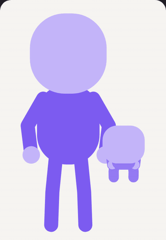
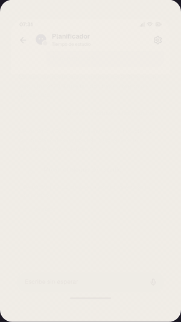

# Medra

Medra explores the interaction between people and technology.

AI is already part of the day, and software can now act without being asked. So what should the relationship between a person and their technology look like, and what would it be like to build the way we use software around that?

The answer takes several shapes. Each one lives here as a project, and they all follow one belief: technology should make people's lives better.

<table>
<tr>
<td width="25%"></td>
<td width="25%"></td>
<td width="25%"></td>
<td width="25%"></td>
</tr>
</table>
