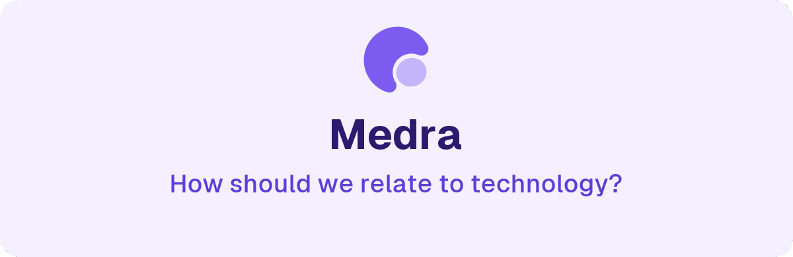
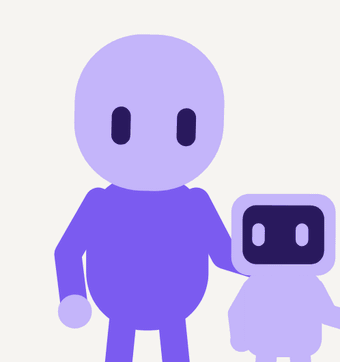

<picture>
  <source media="(prefers-color-scheme: dark)" srcset="img/hero-dark.png">
  
</picture>

Medra explores the interaction between people and technology. AI is already part of the day, and software can now act without being asked, so we build projects that test what a good relationship with it looks like. Each project is a different answer to the same question.

## The idea

For decades a program waited for a tap. An agent does not, so the question changes from what the screen shows to what the machine does when nobody is looking. Four ideas guide every project here.

<picture>
  <source media="(prefers-color-scheme: dark)" srcset="img/cards-dark.png">
  
</picture>

## How it is approached

We build to find out. Each project is a working attempt, and its README says what runs today and what is still a sketch.

## The look

The logo is a crescent that holds a small light. Here it opens from two plain circles.

