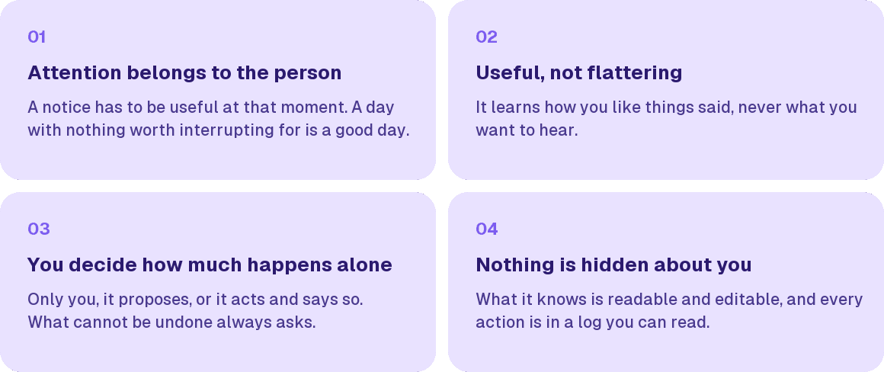

We are Medra, an exploration of how people and technology should interact. AI is already part of the day and software can now act without being asked, so we are looking for what a good relationship with it looks like.

## The idea

We collect ideas about how humans and technology should interact, and we look for ways to try them out. These are the ones we have so far.

<picture>
  <source media="(prefers-color-scheme: dark)" srcset="img/cards-dark.png">
  
</picture>

## Projects

Soon we will publish projects here. Each one is a working attempt at one of these ideas, and its README says what runs today and what is still a sketch.
